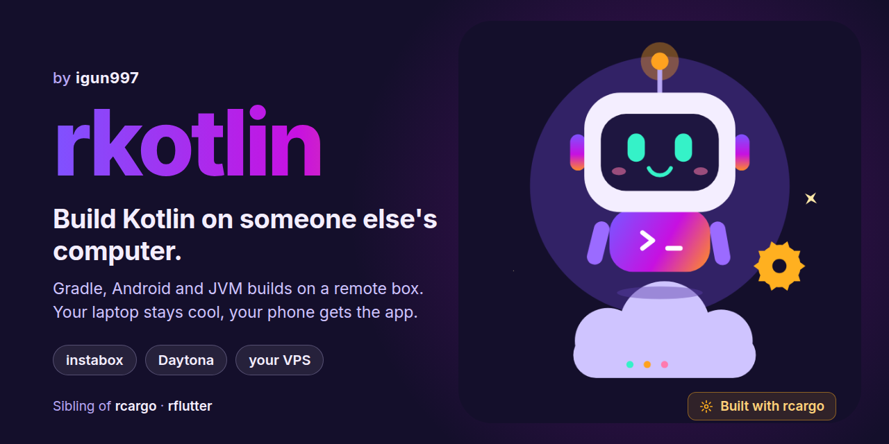

<p align="center">
  
</p>

<p align="center">
  <b>Build and test Kotlin (Gradle, Android, JVM) on someone else's computer, so yours stays cool.</b><br>
  by <a href="https://github.com/igun997">igun997</a> &middot; sibling of <a href="https://github.com/igun997/rcargo">rcargo</a> (Rust) and <a href="https://github.com/igun997/rflutter">rflutter</a> (Flutter) &middot; built with rcargo
</p>

<p align="center">
  
</p>

A Gradle build starts a Gradle daemon and a Kotlin compile daemon, and an Android build adds AGP, R8 and dex on top. On a laptop with 8 GB of RAM that freezes everything, and an AI coding agent will happily start one for you. `rkotlin` runs Gradle on a remote machine ([instabox](https://instabox.sh), [Daytona](https://daytona.io), or any server you can SSH into) and streams the result back. Your editor and your agent keep working; the fan stays quiet. It is the Kotlin sibling of [`rcargo`](https://github.com/igun997/rcargo) (Rust) and [`rflutter`](https://github.com/igun997/rflutter) (Flutter) and works the same way.

- **Your code never goes through GitHub.** The working tree, including uncommitted and private code and `includeBuild("../x")` composite builds, is synced over SSH. Only changed files are sent.
- **Fast after the first build.** The remote keeps `~/.gradle`, every module's `build/` and the Gradle daemon between runs, so a one-line edit is an incremental compile.
- **Android on your phone.** `rkotlin --install assembleDebug` builds remotely, copies the apk back and installs it with your own `adb`.
- **Made for AI agents.** An MCP server, an agent skill, compact output (compiler errors first, failing tests next, progress noise removed) and a guard that stops an agent from running Gradle locally.
- **Official Kotlin skills built in.** JetBrains' and Google's agent skills (Java to Kotlin, AGP 9 migration, Kotlin/Native build performance, R8, testing...) ship inside the binary and install with `rkotlin init`. See [Bundled Kotlin and Android skills](#bundled-kotlin-and-android-skills).
- **You don't need a JDK or Gradle locally.** The first build on a fresh machine installs Temurin JDK 21 there (and Gradle for projects without `gradlew`). The Android SDK installs with `rkotlin remote setup --android`.
- **Many machines.** Register several instances (a small default, a big one for release builds); agents are told which exist and what each is for.
- **Tells you what to do when something is missing.** No instance, not logged in, no API key: you get exact numbered steps, marked when a human is needed.

## Easiest: paste this into your AI agent

Open your project in Claude Code, Codex, Cursor or any agent that can run shell commands, and paste the prompt below.

````text
Set up rkotlin in this project so that Kotlin/Gradle builds and tests run on a remote machine instead of this computer. rkotlin is https://github.com/igun997/rkotlin (read its README if you need details).

Work through these steps in order. Whenever a step needs me (a browser login, an API key, choosing a provider, installing software), stop, tell me in plain words exactly what to do and which command or link to use, and wait for me to say it is done. Never invent or guess credentials, and never ask me to paste secrets into this chat.

1. Check `rkotlin --version`. If it is missing, install the prebuilt binary:
   curl -fsSL https://raw.githubusercontent.com/igun997/rkotlin/main/install.sh | sh
   If that fails, fall back to: CARGO_BUILD_JOBS=2 cargo install --git https://github.com/igun997/rkotlin
2. Go to the folder that contains this project's settings.gradle.kts (or build.gradle.kts) and run `rkotlin init`. It creates rkotlin.toml, installs the agent skill, registers the MCP server and installs a guard that blocks local Gradle builds.
3. Run `rkotlin onboard --live`. If it prints SETUP REQUIRED, follow its steps: run the steps that are not marked [USER] yourself, and for [USER] steps ask me. If no remote machine is configured, ask me which I want and recommend instabox (easiest, has a free tier):
   - instabox: `npx instabox@latest`, then `rkotlin instances add main --backend instabox --default --description "general purpose Kotlin builder"`
   - Daytona: I run `daytona login` (or set DAYTONA_API_KEY), then `rkotlin instances add dt --backend daytona --set snapshot=daytona-large --default --description "Daytona sandbox, 4 vCPU / 8 GB"` (Daytona's default sandbox is 1 vCPU / 1 GB, too small for Gradle)
   - my own server: `rkotlin instances add vps --backend ssh --set host=USER@SERVER --default --description "my build server"` (key-based ssh must already work)
4. If this is an Android project, run `rkotlin remote setup --android` once (about 600 MB on the remote).
5. Run `rkotlin remote doctor`, then `rkotlin build` (or `rkotlin test`) and show me the result. The first build installs the JDK on the remote and downloads dependencies, which takes a few minutes.
6. From now on never run gradle or ./gradlew on this computer. Use `rkotlin <the same arguments>` instead, or the `gradle` tool of the rkotlin MCP server. Read .claude/skills/rkotlin/SKILL.md (or .agents/skills/rkotlin/SKILL.md) now and follow it.
7. Tell me in plain English what you set up, which instance is the default, that I may need to restart this agent so it loads the new MCP server and skill, and that `rkotlin remote down` pauses the remote machine to save money (it wakes up by itself on the next build).
````

Already set up and just want to add another machine later? Paste this instead:

````text
Add another remote build machine to rkotlin. Run `rkotlin instances` to see what exists, ask me which provider I want (instabox, Daytona, or my own SSH server), do the steps that do not need me, and ask me for the ones that do (logins, keys). Register it with `rkotlin instances add NAME --backend ... --description "what this machine is good for"` (for Daytona add `--set snapshot=daytona-large`), then verify with `rkotlin -i NAME remote doctor` and `rkotlin -i NAME build`, and tell me how to use it (`rkotlin -i NAME assembleRelease`). If it is for an Android project, also run `rkotlin -i NAME remote setup --android` and tell me it needs about 600 MB.
````

Want to get an Android app onto your phone, or convert Java to Kotlin, with the official Kotlin skills (after rkotlin is set up)? Paste this:

````text
I want to work on this Kotlin/Android project with rkotlin. Read .claude/skills/rkotlin/SKILL.md (or .agents/skills/rkotlin/SKILL.md) first; if it is missing, run `rkotlin init` in the folder with settings.gradle.kts. Run EVERY Gradle command through rkotlin (`rkotlin <args>` or the `gradle` MCP tool), never `./gradlew` or `gradle` on this computer, including when another skill tells you to.

1. Run `rkotlin remote doctor` and show me anything marked FAIL. If it is an Android project and the remote has no Android SDK, ask me before running `rkotlin remote setup --android`. If it says services.gradle.org is not reachable, tell me; do not edit gradle-wrapper.properties without asking.
2. Run `rkotlin skills` and tell me which bundled skill fits what I want to do (for example kotlin-tooling-java-to-kotlin for converting Java files, agp-9-upgrade or kotlin-tooling-agp9-migration for an AGP 9 upgrade, r8-analyzer for shrinker rules, testing-setup for a test strategy). Read that skill and follow it.
3. Build and test with `rkotlin build` and `rkotlin test` (or the specific tasks), fix compiler errors from the top, and rerun until they pass.
4. When I ask for it, and only then, put the app on my phone: `rkotlin devices` to see what adb sees, then `rkotlin --install assembleDebug` (add `=SERIAL` if several phones are attached). Never install without asking.
5. Finish by telling me what changed, the commands you ran, and the apk path under app/build/outputs/apk/.

## Quick start (3 steps)

```sh
# 1. install (a prebuilt binary, nothing to compile)
curl -fsSL https://raw.githubusercontent.com/igun997/rkotlin/main/install.sh | sh

# 2. inside your Gradle project folder: set everything up
rkotlin init

# 3. build and test on the remote machine
rkotlin build
```

Any `rkotlin <anything>` that is not an rkotlin command is passed to Gradle and runs remotely (`./gradlew` if the project has one, otherwise the remote's `gradle`):

```sh
rkotlin build
rkotlin :app:assembleDebug
rkotlin test --tests '*GreeterTest'
rkotlin lintDebug
rkotlin --pull assembleRelease        # copy apk/aab/jar outputs back into your local build/ directories
rkotlin --install assembleDebug       # ...and install the apk on your phone with your local adb
rkotlin gradle init                   # the explicit form, for names rkotlin shadows (init)
```

Gradle options go after the task (`rkotlin build --info`). Run from a module directory and rkotlin passes `-p <module>`.

## Android

```sh
rkotlin remote setup --android     # once per machine: command-line tools, platform-tools, android-35, build-tools 35.0.0
rkotlin --install assembleDebug    # build remotely, install on the only attached phone
rkotlin --install=SERIAL assembleDebug
rkotlin devices                    # what your local adb sees
```

`local.properties` (your machine's `sdk.dir`) is never uploaded; the remote gets `ANDROID_HOME` from the setup. `--install` needs `adb` on your computer (`PATH`, `ANDROID_HOME` or `~/Android/Sdk`), exactly one phone or `--install=SERIAL`, and a build that produced exactly one apk from the latest run. Wireless debugging works the same as USB. The MCP server has no install option: an agent builds, you decide what goes on your phone.

`remote.android_packages` in `rkotlin.toml` changes the sdkmanager packages (default `platform-tools`, `platforms;android-35`, `build-tools;35.0.0`).

## Instances (several machines)

```sh
rkotlin instances                                   # list with live state and descriptions
rkotlin instances add big --backend ssh --set host=me@build.example.com \
      --description "32-core server, use for release builds"
rkotlin instances add dt  --backend daytona --set snapshot=daytona-large --description "Daytona sandbox, 4 vCPU / 8 GB"
rkotlin instances use big                           # make it the default
rkotlin instances discover                          # find boxes your accounts already have
rkotlin -i big build                                # pick per command (or RKOTLIN_INSTANCE=big)
```

Choice order: `-i` / `RKOTLIN_INSTANCE`, then `instance = "NAME"` in the project's `rkotlin.toml`, then your default, then the only instance. With several instances and no default, rkotlin asks you (or the agent) to choose instead of guessing.

| Backend | What it needs | Notes |
|---|---|---|
| `instabox` | `INSTABOX_API_KEY` (REST API, **no CLI needed**) or the `instabox` CLI, signed in | box is created on first use (`--set box=NAME`). Default box is 4 vCPU / 8 GiB. |
| `daytona` | `daytona login` (rkotlin reuses the CLI's stored login) or `DAYTONA_API_KEY`; `curl` | sandbox is created on first use. Pick a big enough snapshot: `--set snapshot=daytona-large`. |
| `ssh` | key-based ssh to `host` | your own VPS or desktop. Linux with `bash`, `tar`, `find`, `flock`; `curl` and `unzip` (installed with sudo/root if missing). |

Credentials, reusing existing machines, `remote down` / `destroy` and the other housekeeping commands behave exactly as in `rcargo`; `rkotlin remote ls`, `gc`, `rm`, `status`, `doctor` are the same.

## AI agents

- **MCP**: `rkotlin mcp` (stdio). Tools: `gradle`, `shell`, `sync`, `instances`, `setup`, `power`, `workspaces`. `rkotlin init` writes `.mcp.json`; other clients: `claude mcp add rkotlin -- rkotlin mcp`, `codex mcp add rkotlin -- rkotlin mcp`.
- **Skills**: `skills/rkotlin/SKILL.md` (installed into `.claude/skills` and `.agents/skills`) teaches the agent to use rkotlin. `rkotlin init` also installs the bundled official Kotlin and Android skills, see below.
- **Guard**: a Claude Code hook (`rkotlin hook`) that blocks local `gradle` / `./gradlew` builds (anything but `--version`, `tasks`, `wrapper`, `clean`, `dependencies` and similar) with a message pointing to the rkotlin equivalent. Override once with `RKOTLIN_ALLOW_LOCAL=1 ./gradlew ...`.
- **Setup guidance**: failures caused by missing prerequisites exit with code 3 (CLI) or return `isError` plus `structuredContent.setup_required` (MCP), with steps marked `needs_user` when a human must act.

### Bundled Kotlin and Android skills

`rkotlin` ships the official agent skills, vendored unchanged with their Apache-2.0 license and embedded in the binary (so they install offline):

| Source | Skills |
|---|---|
| [JetBrains/Kotlin: kotlin-agent-skills](https://github.com/Kotlin/kotlin-agent-skills) | `kotlin-tooling-java-to-kotlin`, `kotlin-tooling-agp9-migration`, `kotlin-tooling-native-build-performance`, `kotlin-tooling-cocoapods-spm-migration`, `kotlin-tooling-immutable-collections-0-5-x-migration`, `kotlin-backend-jpa-entity-mapping`, `kotlin-tooling-kotlin-toolchain`, `kotlin-tooling-kotlin-toolchain-plugin-authoring`, `kotlin-tooling-gradle-to-kotlin-toolchain-project`, `kotlin-tooling-gradle-to-kotlin-toolchain-plugin` |
| [Google: android/skills](https://github.com/android/skills) | `agp-9-upgrade`, `r8-analyzer`, `testing-setup` |

```sh
rkotlin skills                        # list them with their upstream URL and commit
rkotlin skills add r8-analyzer        # install one into .claude/skills and .agents/skills
rkotlin skills add --all --global     # install all of them for your user
rkotlin integrate --skill --no-kotlin-skills   # only the rkotlin skill
```

`rkotlin init` installs all of them. The rkotlin skill tells the agent to run `rkotlin ...` wherever those skills say `./gradlew ...`. Provenance (exact upstream commit per skill) is in `skills/kotlin/SOURCES.tsv`.

Compact output looks like this:

```
instance: dt (daytona) | FAILED (exit 1) | 21.4s total, sync 3 of 41 files (6.2 KiB) in 0.8s
== diagnostics: 1 error(s), 0 warning(s) ==
error: /home/me/app/app/src/main/kotlin/Main.kt:9:13 Unresolved reference 'foo'

== failure ==
compilation failed (see diagnostics above)

BUILD FAILED in 18s
(23 progress lines hidden)
```

## Configuration

`rkotlin.toml` in the project, `~/.config/rkotlin/config.toml` (`$RKOTLIN_CONFIG`) for instances:

```toml
instance = "dt"
[sync]
exclude = ["docs/videos"]
[remote]
jdk = 17                                  # Temurin major version (default 21)
forward_env = ["GITHUB_TOKEN"]            # copied from your shell at run time, never written to disk
# gradle = "./gradlew"                    # override the command
# android_packages = ["platforms;android-34", "build-tools;34.0.0"]
```

## How it works

1. **Sync.** One SSH round trip lists size, mtime and mode of the files already on the remote. Only differences are sent, as a tar stream over the same SSH session; deletions are propagated only for files rkotlin itself sent. `.gitignore`, `.ignore` and `.rkotlinignore` are honoured. `.git/`, `.gradle/`, `.kotlin/` and each module's `build/` (a `build/` next to a `build.gradle[.kts]`) are never sent, so a source package called `build` still travels. Files are mirrored at their absolute local path, so `includeBuild("../shared")` and `projectDir = file("../m")` just work (literal relative paths in `settings.gradle[.kts]`).
2. **Run.** The same session takes a per-workspace lock (parallel agents queue instead of corrupting each other), extracts the tar, and runs `./gradlew --console=plain ...` with the JDK from `~/.rkotlin`.
3. **Stream back.** stdout/stderr are streamed live; remote paths in output are rewritten to local ones, so editors and agents can jump to files. Exit codes are preserved.

Never uploaded unless you set `sync.default_excludes = false`: `.env`, `.env.local`, `*.pem`, `*.key`, `id_rsa*`, `id_ed25519*`, `.npmrc`, `*.jks`, `*.keystore`, `key.properties`, `keystore.properties`, `local.properties`. A signed release build needs you to opt in (see the skill), and signing passwords travel through `forward_env`.

## Limits (read these)

- The remote must be Linux (Debian/Ubuntu images are what `rkotlin remote setup` knows). The client runs on Linux and macOS.
- Gradle only (no Maven, no Bazel). Kotlin Multiplatform targets that need macOS (iOS) cannot build on a Linux instance.
- No gradle wrapper? `rkotlin gradle wrapper --gradle-version X.Y.Z` creates one on the remote and copies `gradlew`, `gradlew.bat` and `gradle/wrapper/` back into your project; commit them.
- Some sandboxes block hosts: Daytona's lower tiers cannot reach `services.gradle.org`, `plugins.gradle.org` or `api.adoptium.net`, while GitHub, Maven Central and `dl.google.com` work. `rkotlin remote setup` falls back to GitHub and the distro packages for the JDK and Gradle, but a gradle wrapper still downloads Gradle from its `distributionUrl`: point it at `https://github.com/gradle/gradle-distributions/releases/download/vX.Y.Z/gradle-X.Y.Z-bin.zip`. Plugins that exist only on the Gradle plugin portal will not resolve there. `rkotlin remote doctor` checks this.
- Instrumented tests (`connectedAndroidTest`) need a device attached to the remote and will not find your phone.
- Your sources are uploaded to the provider you choose. Use a provider you trust for private code.
- `gradle.properties` that sets `org.gradle.java.home` to a path on your machine breaks the remote build; `rkotlin remote doctor` warns about it.

## Development

```sh
rcargo test       # unit tests + end-to-end suite (real binary, fake ssh, fake gradlew and adb)
```

### Mascot and banner

Kodi, the mascot, is a Lottie animation generated by `assets/mascot/source/gen-mascot.mjs` (the editable version has Skottie slots for the colors, so it opens in the [diffusionstudio/lottie](https://github.com/diffusionstudio/lottie) player; `examples/hello-android` plays the slot-free variant with lottie-android). `render-frames.mjs` renders it to PNG frames with the same Skottie build, `assets/mascot/mascot.gif` is what the README shows (GitHub does not render Lottie JSON), and `assets/banner.png` (1280x640) is built from `assets/banner/banner.html` with headless Chrome. To use the banner as the link preview on social networks, upload `assets/banner.png` under Settings, Social preview of the GitHub repository.

MIT licensed.

## Credits

The bundled agent skills are the work of their authors and are vendored unchanged under Apache-2.0 (each skill folder keeps its `LICENSE.txt`; the exact upstream commit is in `skills/kotlin/SOURCES.tsv`):

- **JetBrains**, [Kotlin/kotlin-agent-skills](https://github.com/Kotlin/kotlin-agent-skills): the `kotlin-*` skills.
- **Google**, [android/skills](https://github.com/android/skills) (see also [developer.android.com/tools/agents/android-skills](https://developer.android.com/tools/agents/android-skills)): `agp-9-upgrade`, `r8-analyzer`, `testing-setup`.

rkotlin follows the design of `rcargo` and `rflutter`. See [NOTICE](NOTICE).
